# Orbital

A calm, ADHD-, ADD- and autism-friendly idea and project tracker. You can capture things in seconds, decide later one question at a time, and finish in small steps. Parking an idea counts as a decision, and taking a pause is never punished.

Orbit, the little satellite in the sidebar, shows how things stand: it orbits quietly when nothing is urgent, does a fast lap when you finish something, and waits at the top while something must happen.



- **To-do:** a simple list for little things that do not need a project. You can move any item into a project later.
- **Scratch:** a plain notepad that saves itself. Press "Sort" and lines become ideas or to-dos.
- **Ideas:** park first, then evaluate with a short step-by-step flow:
  1. Eisenhower: important? urgent? → Do now, Schedule, Delegate, Drop or defer
  2. Core and Context (Geoffrey Moore): would a customer notice? does it hurt within a week? → Invent, Deploy, Manage, Offload
  3. Economics (optional): money, time, delegation → nine fixed rules plus a marked fallback
- **Must happen:** contracts, legal, security or blockers can be marked on any idea, project or task. These items always stay on top and are never hidden by the matrix.
- **Projects:** tasks with big tick boxes and a progress bar. "Today" shows exactly one next step.
- **Points and streaks** reward finishing, parking and dropping on purpose. Missing a day simply starts a new streak.
- **Multi-user:** local accounts. Every person has a private orbit with their own ideas, projects, points, scratchpad and home.
- **Local AI (optional):** suggestions for ideas, next small steps for projects, sorting help, a weekly digest and chatting with Orbit, all from your own Ollama, LM Studio, llama.cpp or vLLM server. It only suggests things, and it only runs when you press a button.
- **Your house:** a small 3D house (three.js, served locally) with a living room, a workshop and a garden. You furnish it with the points you earned. Tap Orbit or your level to visit. It is purely cosmetic.

Everything runs in one Docker container with a SQLite file. It needs no cloud and no internet at runtime, and loads nothing from a CDN.

## Stack

- Backend: **Node.js 22 with Express 5 and better-sqlite3**
- Frontend: one HTML file, one CSS file and `app.js`. No framework and no build step. The 3D house lives in `room.js` and `furniture.js`, which only load when you open it.
- 3D: **three.js 0.186.1**, installed through npm and served by Orbital itself under `/vendor/three/`. No CDN.
- Database: `DATA_DIR/orbital.sqlite`. The schema is created on start, with a `migrations` table and version numbers.

## Quick start

You need [Docker Desktop](https://www.docker.com/products/docker-desktop/) (Windows, macOS) or Docker Engine with the compose plugin (Linux).

```bash
git clone <your-repo-url> orbital
cd orbital
cp .env.example .env
docker compose up -d
```

Open <http://localhost:8080>. The first person to open Orbital creates the admin account.

### Windows

1. Install Docker Desktop and start it.
2. In PowerShell: `git clone <your-repo-url> orbital`, then `cd orbital` and `copy .env.example .env`.
3. `docker compose up -d`, then open <http://localhost:8080>.
4. If port 8080 is taken, set `PORT=8090` in `.env` and run `docker compose up -d` again.

### macOS

Same as above in Terminal. Docker Desktop handles file permissions for `./data`.

### Linux

```bash
cp .env.example .env
echo "ORBITAL_UID_GID=$(id -u):$(id -g)" >> .env
mkdir -p data
docker compose up -d
```

The container runs as your user, so `./data` stays writable and owned by you.

### Proxmox VE (LXC, without Docker)

Run this on the Proxmox host as root:

```bash
curl -fsSLO https://raw.githubusercontent.com/lcsfls/orbital/main/scripts/proxmox-lxc.sh
less proxmox-lxc.sh   # have a look first
bash proxmox-lxc.sh
```

- The script asks for an ID, hostname, disk size, CPU, RAM, bridge, IP (DHCP or static) and port.
- **Storage is never guessed.** You pick the storage for the container disk and the one for the template, and only storages that Proxmox reports as active and allowed for `rootdir` or `vztmpl` show up. Free space is checked before anything is created. If no suitable storage exists, the script stops and explains why.
- It creates an unprivileged Debian container (1 core, 512 MB RAM, 4 GB disk by default) and installs Node.js 22 (official binary, checksum verified) and Orbital as a systemd service. No Docker.
- Optionally it creates a setup token, so nobody else can create the first admin account before you.
- Data lives in `/var/lib/orbital` and settings in `/etc/orbital/orbital.env`. A normal Proxmox backup of the container includes everything.
- To update: `pct exec <id> -- orbital-update`.
- For unattended runs, set the answers as variables, for example `YES=1 CTID=120 STORAGE=local-lvm TEMPLATE_STORAGE=local BRIDGE=vmbr0 IP=dhcp bash proxmox-lxc.sh`. The variables are listed at the top of the script.

### Without Docker (development)

```bash
npm ci
npm start            # http://localhost:8080, data in ./data
HOME_ENABLED=true AI_ENABLED=true npm run dev
```

## Configuration

All settings live in `.env` (see `.env.example`):

| Variable | Default | Meaning |
|---|---|---|
| `PORT` | `8080` | Host port |
| `TZ` | `UTC` | Time zone for days, streaks and snapshots |
| `ORBITAL_UID_GID` | `1000:1000` | Container user (Linux) |
| `SETUP_TOKEN` | empty | If set, creating the first admin requires this token |
| `COOKIE_SECURE` | `auto` | `auto`, `true` or `false` for the session cookie |
| `TRUST_PROXY` | empty | Number of trusted reverse proxy hops, e.g. `1` behind Traefik |
| `HOME_ENABLED` | `true` | The 3D house. Set `false` to hide it |
| `AI_ENABLED` | `false` | Enables local AI features |
| `AI_BASE_URL` | `http://host.docker.internal:11434/v1` | OpenAI-compatible endpoint |
| `AI_MODEL` | `llama3.1:8b` | Model name |
| `AI_API_KEY` | empty | Only if your server needs one |
| `AI_TIMEOUT_MS` / `AI_MAX_TOKENS` | `60000` / `800` | Limits per call |

Admins can change the AI settings later in the app (Settings → Local AI). The values in `.env` are only defaults.

## Accounts and people

- On first start Orbital shows "Welcome to Orbital", and the account you create becomes the admin.
- Every new account gets a short setup (about a minute, skippable): give your companion a name and a colour, say what it should call you, choose how lively things should be, and optionally add a first to-do. You can change all of it later under **Settings → Your companion** or run the setup again.
- Admins add people under **Settings → People**. They can set a new password, pause an account, make someone admin or delete them (which also deletes that person's data). There is always at least one active admin.
- Everyone can change their name and password under **Settings → You**.
- Passwords are stored as scrypt hashes. Sessions use an HttpOnly, SameSite=Lax cookie, stay valid while in use and expire after 30 idle days. Every write request needs an `X-Orbital: 1` header (CSRF protection). After 10 failed logins within 15 minutes, logins for that name and address are paused.
- Data is separated per user in every query. People never see each other's ideas.

## Homelab setup

`docker-compose.yml` contains a commented-out Traefik block (labels for a router, TLS and an optional Authelia forward-auth middleware).

1. Remove the `ports` block if Traefik is the only way in.
2. Put the container on your proxy network (`networks: proxy`).
3. Set `TRUST_PROXY=1` so secure cookies work behind TLS termination.
4. Set a `SETUP_TOKEN` until you have created the admin account.
5. Authelia is optional. Orbital has its own accounts, so forward auth just adds a second layer.

For a local model on the same machine, `host.docker.internal` already points to the host (via `extra_hosts`). For Ollama on another box, use its LAN address, for example `http://192.168.1.20:11434/v1`.

## Backup and restore

**Backup:** copy the `./data` folder. Stop the container first so SQLite's WAL files are flushed:

```bash
docker compose stop
cp -r data data-backup-2026-10-10
docker compose start
```

**Restore:** stop the container, replace `./data` with your copy, start again.

**Per person:** Settings → Backup → "Download my data" gives a JSON file with your ideas, projects, tasks, points, home and scratchpad. "Load a file" adds its contents next to your data. With "Replace my current data" it restores, and only your own data is affected.

## Importing old Planer files

Files saved with the old `planer.html` prototype (`planer_YYYY-MM-DD.json`) can be loaded via Settings → Backup → "Load a file".

- German statuses and answers are translated (`parkplatz` → parked, `ja` → yes, …).
- Old "evaluated" ideas come in as **parked**, because the Eisenhower step is now required first. Their money/time/delegation answers are kept and apply once you answer the Eisenhower questions.
- Projects and tasks keep their links to ideas.

## Your house

- Open it by tapping Orbit or your level in the sidebar (on a phone, at the top), or from the **Home** tab.
- There are three rooms: living room, workshop and garden. Each one is a grid. Use the arrow buttons or drag the floor to turn the view, and pinch or use the mouse wheel to zoom.
- **Hang out:** tap the floor and Orbit floats there. Tap a thing to use it, for example sit on the sofa, switch the lamp, water the plant, print a gear or pick an apple. The same actions are also buttons in the panel.
- **Arrange:** drag a thing from "Your things" up into the room, or tap it. In the room you drag things around with your finger, and they snap to the grid (green means free, red means taken). The buttons Turn, Put away and Done are always in the same place in the panel. On a keyboard: arrow keys move, R turns, Q and E turn the view.
- **Shop:** tap once to see the price, tap again to get it. Points come only from real progress, and spending them never lowers your level.
- **Garden:** grass grows a little on days without finished tasks, but never more than halfway. Press "Mow the lawn" and swipe over it. At 85 % it counts as done.
- **Ask Orbit:** type a question or tap a suggestion. Without AI, Orbit answers from your open tasks. With AI it uses your local model and only refers to your real items.
- Reduced motion or "Celebrations off": Orbit stops wandering and bobbing, there are no particles, and moves happen instantly.

## Local AI

The easiest way is the bundled Ollama container:

```bash
docker compose --profile ai up -d
docker compose exec ollama ollama pull llama3.2:3b
```

Then set `AI_ENABLED=true`, `AI_BASE_URL=http://ollama:11434/v1` and `AI_MODEL=llama3.2:3b` in `.env` and run `docker compose up -d` again. Models are stored in `./ollama`. For an NVIDIA GPU, uncomment the `deploy` block in `docker-compose.yml`.

Or point `AI_BASE_URL` at any OpenAI-compatible server you already run:

| Server | Typical base URL |
|---|---|
| Ollama | `http://host.docker.internal:11434/v1` |
| LM Studio | `http://host.docker.internal:1234/v1` |
| llama.cpp server | `http://host.docker.internal:8080/v1` |
| vLLM | `http://host.docker.internal:8000/v1` |

- "Test the connection" in Settings sends a one-line prompt and shows the model name and latency. The model dropdown lists what your server offers (`/v1/models`).
- **Suggest next steps** (in an open project) proposes 3 to 5 small new tasks. You untick or reword them before they are added.
- **Ask Orbit** in the house uses `backend/prompts/orbit-chat.md` together with a short summary of your open tasks.
- **Suggest** (in an idea's details) proposes a cleaner title, 3 to 6 small steps and the quadrants with a reason. You can edit everything, and nothing is saved until you accept.
- **Sort with AI** in the scratchpad review groups lines and proposes titles and quadrants.
- **Weekly digest** on Today summarises completed, parked and dropped items of the last 7 days.
- Calls go from the backend to the configured endpoint only, and only when you press a button. Prompts live in `backend/prompts/*.md` (English, versioned).

## API

All endpoints return JSON. Errors look like `{ "error": "validation_error", "message": "..." }`. Everything except `/healthz`, `/api/config` and `/api/auth/*` needs a session. Every request other than GET also needs the `X-Orbital: 1` header.

| Method | Path | |
|---|---|---|
| GET | `/healthz` | Health check |
| GET | `/api/auth/status` · POST `/api/auth/setup` · `/login` · `/logout` · `/password` · PATCH `/profile` | Accounts |
| GET, POST, PATCH, DELETE | `/api/users[/:id]` | People (admin) |
| GET, POST, PATCH, DELETE | `/api/ideas[/:id]` | Ideas |
| POST | `/api/ideas/:id/make-project`, `/api/ideas/:id/review` | Convert, quadrant review |
| GET, POST, PATCH, DELETE | `/api/projects[/:id]` | Projects (with tasks) |
| POST | `/api/projects/:id/review` | Quadrant review |
| GET, POST, PATCH, DELETE | `/api/tasks[/:id]` | Tasks |
| GET | `/api/stats` | Overview numbers, hints, open must-happen items |
| GET, PATCH | `/api/gamification` | XP, level, streak, Orbit state, settings |
| GET, PUT | `/api/scratch` | Scratchpad |
| GET, POST | `/api/scratch/snapshots`, `/api/scratch/snapshots/:day/restore` | Daily snapshots (30 days) |
| POST | `/api/inbox/preview`, `/api/inbox/apply` · GET `/api/inbox/history` | Sorting |
| POST | `/api/orbit/ask` | Ask Orbit (AI if enabled, otherwise rule based) |
| GET, POST | `/api/rules`, `/api/evaluate` | Rule tables, live evaluation |
| GET, POST | `/api/export`, `/api/import?mode=merge|replace` | JSON backup |
| GET, POST, PATCH | `/api/home`, `/api/home/buy`, `/api/home/mow`, `/api/home/placements`, `/api/home/layout` | House |
| GET, PATCH, POST | `/api/ai/settings`, `/api/ai/models`, `/api/ai/test`, `/api/ai/suggest/:id`, `/api/ai/project-steps/:id`, `/api/ai/inbox`, `/api/ai/digest` | Local AI (if enabled) |

## XP rules

| Action | XP |
|---|---|
| Finish a task | 20 |
| Finish something that must happen | 30 |
| Complete a project | 100 |
| Evaluate an idea | 15 |
| Quadrant review when due (every 90 days) | 15 |
| Park an evaluated idea | 10 |
| Drop an idea on purpose | 10 |
| Sort the scratchpad to empty (once a day) | 10 |
| New idea (first 3 per day) | 5 |

Every action is rewarded once per item, so toggling something back and forth earns nothing extra. The level for total XP *n* is the largest *L* with 50·L·(L−1) ≤ *n*. Spending points in Home never lowers your level.

## Tests

```bash
npm test             # unit, API, multi-user and the Docker smoke test
npm run test:smoke   # only the container test
```

The smoke test builds the image, starts a container, calls `/healthz`, creates data, restarts the container and checks that the data is still there. It is skipped when Docker is not available, unless `SMOKE_REQUIRED=1` is set.

## Manual test checklist

- [ ] `docker compose up -d`, open the app, create the admin account. The setup follows: pick a name and colour for the companion, and the sidebar robot takes that colour.
- [ ] Ideas: type an idea, press Enter. It shows "Parked. Not evaluated yet." and +5 XP.
- [ ] Open it, "Evaluate now": one question per step, back works, result shows, Save gives +15 XP.
- [ ] Choose context + "hurts within a week": the next step suggests "must happen" with reason "Context, mission-critical", the economics step is skipped, the result is "Keep running – minimise effort".
- [ ] Mark an idea as must happen with "Not important / Not urgent": it stays first in the list, Today shows "One thing needs you", Orbit waits with a badge.
- [ ] "Make it a project", add two tasks, tick one: +20 XP, Orbit does a fast lap, a little confetti.
- [ ] Today shows exactly one next step, and "Not now, show another" switches to the next.
- [ ] To-do: add three things with Enter, tick one off (+20 XP), it moves to "Done". "Move to a project" moves an item, and "Clear done items" empties the done list.
- [ ] Scratch: type 4 lines (one with "-", one ending with "?"), wait for "Saved", press Ctrl+Enter, untick one, accept: the unticked line stays and the rest is created.
- [ ] Ctrl+Shift+N jumps to Scratch from any view (some browsers reserve this shortcut. Then use the sidebar).
- [ ] Paste three lines into the idea field: the sorting review opens instead of a long title.
- [ ] Settings → Comfort: turn celebrations off, finish a task, nothing moves.
- [ ] Turn on "reduce motion" in the OS: Orbit stays still and shows only the badge.
- [ ] Settings → People: add a person, sign in as them in a private window, check their orbit is empty.
- [ ] Settings → Backup: download, then load the file with "Replace" in a second account.
- [ ] Load an old `planer_*.json`.
- [ ] `docker compose restart`, reload the page: everything is still there and you are still signed in.
- [ ] Tap Orbit: the living room opens. Tap the sofa and Orbit sits down. Tap the lamp and it switches on.
- [ ] Arrange on a phone: drag a thing from the tray into the room, drag it to another spot, turn it, put it away. Buy something in the shop: the level stays the same.
- [ ] Garden with grown grass: "Mow the lawn", swipe over it, and it says "Fresh start." or "Pause is fine."
- [ ] Ask Orbit "What should I do next?": the answer names one of your open tasks.
- [ ] With `AI_ENABLED=true` and Ollama running: Settings → Local AI → Test works and the model list fills. Suggest shows editable proposals, and Discard changes nothing. "Suggest next steps" in a project adds only the ticked steps.
- [ ] Phone width: bottom navigation, the side panel takes the full screen.

## Roadmap

- House: more rooms and things, using the same save format (placements with `pos`).
- Phase 3: Screen Companion. This is design only, see [docs/screen-companion.md](docs/screen-companion.md).

## License

MIT, see [LICENSE](LICENSE).
